# Anexo F. Figuras complementarias

**Se cita en:** apartados 3.1 y 3.9 del manuscrito; las figuras corresponden a los apartados 3.1, 3.2, 3.4, 3.5, 3.6, 3.7 y 3.9.
**Scripts:** `datos_11.analisis-descriptivo.R` (y `datos_12.figura-area-x-linea.R`, que genera la Figura 2), `datos_13.mapa-entidades.R` y `datos_16.mca-exploratorio.R`. **Archivos:** carpeta `figuras/`.

## F.1 Correspondencia entre archivo y número

Las Figuras 1 y 2 están en el cuerpo del artículo. Las quince restantes se numeran de la 3 a la 17 en el orden de lectura del manuscrito: primero por el apartado donde se discute su contenido y, dentro de cada apartado, por el orden en que el texto presenta las variables. Los nombres de archivo conservan el orden de generación de los scripts y no se renombran, para no romper la trazabilidad con el código.

| Figura | Archivo | Título | Base | Apartado |
|---|---|---|---|---|
| 1 | `fig02_linea_doctorado.png` | Línea de doctorado de mayor interés (en el manuscrito) | n = 100 | 3.3 |
| 2 | `fig13_area_x_linea.png` | Línea temática según el área disciplinaria (en el manuscrito) | n = 100 | 3.8 |
| 3 | `fig16_mca_vista_general.png` | Análisis de correspondencias múltiples de las variables de demanda: vista general | n = 98 | 3.1 |
| 4 | `fig17_mca_detalle_cumulo.png` | Análisis de correspondencias múltiples: detalle del cúmulo central | 15 categorías | 3.1 |
| 5 | `fig01_interes_doctorado.png` | Interés en cursar el doctorado | n = 113 | 3.2 |
| 6 | `fig03_genero.png` | Género de las personas interesadas | n = 100 | 3.4 |
| 7 | `fig04_edad.png` | Edad de las personas interesadas, por rango quinquenal | n = 100 | 3.4 |
| 8 | `fig07_area_maestria.png` | Área disciplinaria de la maestría de las personas interesadas | n = 100 | 3.4 |
| 9 | `fig08_situacion_laboral.png` | Situación laboral de las personas interesadas | n = 98 | 3.4 |
| 10 | `fig09_motivacion.png` | Motivación principal para cursar el doctorado | n = 100 | 3.5 |
| 11 | `fig10_tiempo_inicio.png` | Plazo estimado para iniciar el doctorado | n = 100 | 3.6 |
| 12 | `fig11_situacion_x_tiempo.png` | Plazo estimado de inicio según situación laboral (RQ6) | n = 98 | 3.7 |
| 13 | `fig12_situacion_x_motivacion.png` | Motivación principal según situación laboral (RQ6) | n = 98 | 3.7 |
| 14 | `fig05_estado_estudios.png` | Entidad federativa donde se cursó la maestría | n = 100 | 3.9 |
| 15 | `fig06_estado_residencia.png` | Lugar de residencia actual | n = 100 | 3.9 |
| 16 | `fig14_mapa_estado_estudios.png` | Personas interesadas por entidad donde cursaron la maestría | n = 100 | 3.9 |
| 17 | `fig15_mapa_estado_residencia.png` | Personas interesadas por entidad de residencia | n = 100 | 3.9 |

Las imágenes no llevan el título incrustado: el título y la fuente se escriben fuera de la imagen, como piden las normas de la revista. El tamaño de muestra figura dentro de cada imagen.

## F.2 Figuras

**Figura 3.** Análisis de correspondencias múltiples de las variables de demanda: vista general (n = 98)

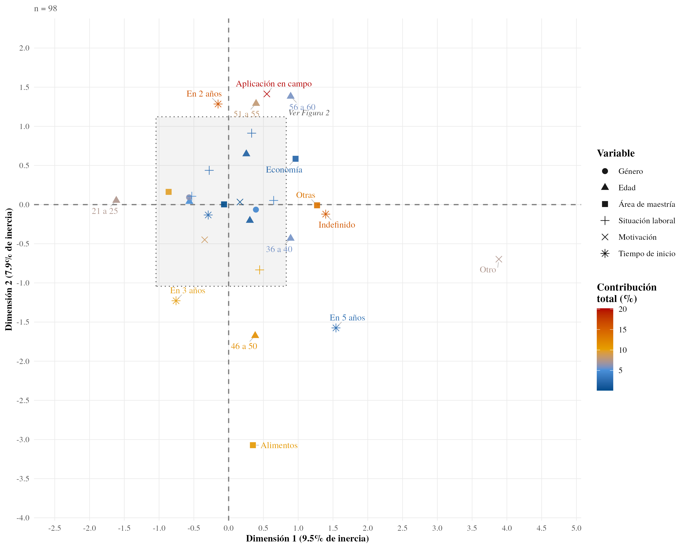

*Nota.* Los ejes son las dos primeras dimensiones del análisis, con el porcentaje de inercia que explica cada una; no tienen unidades. La forma del marcador indica la variable y el color, la contribución de la categoría a los ejes (%). El área sombreada es la región ampliada en la Figura 4.

Fuente: Elaboración propia.

**Figura 4.** Análisis de correspondencias múltiples: detalle del cúmulo central (15 categorías)

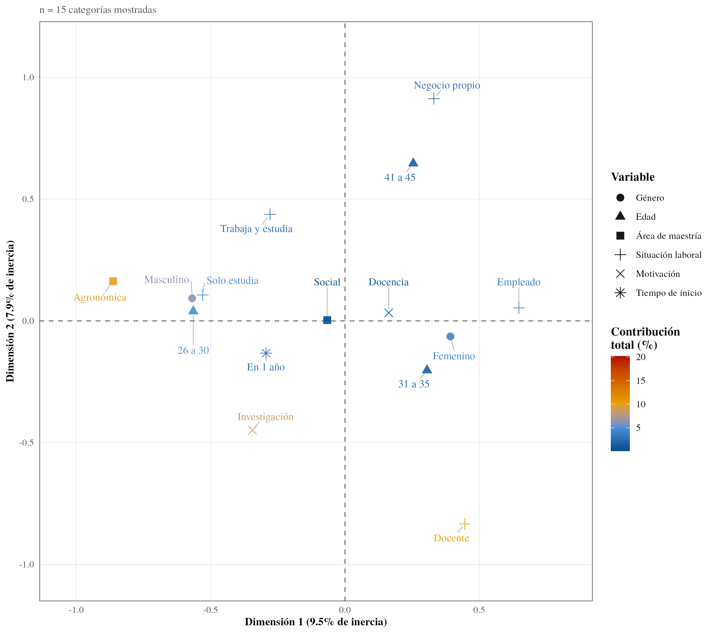

*Nota.* Ampliación de la región sombreada de la Figura 3, con los mismos ejes y la misma codificación de forma y color.

Fuente: Elaboración propia.

**Figura 5.** Interés en cursar el doctorado (n = 113)

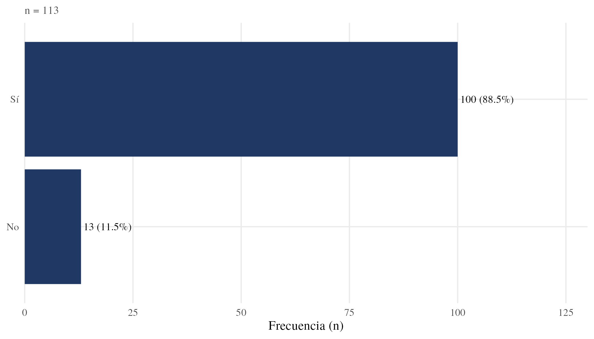

*Nota.* El eje horizontal muestra la frecuencia absoluta (n); junto a cada barra se indica el porcentaje sobre las 113 respuestas.

Fuente: Elaboración propia.

**Figura 6.** Género de las personas interesadas (n = 100)

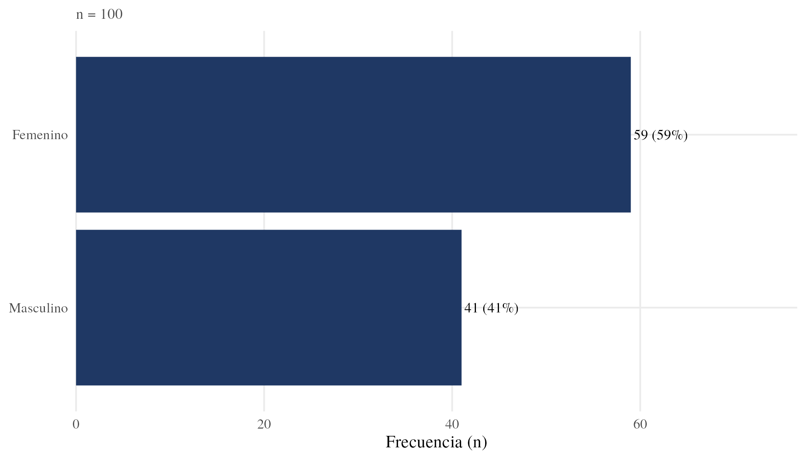

*Nota.* El eje horizontal muestra la frecuencia absoluta (n); junto a cada barra, el porcentaje sobre las 100 personas interesadas.

Fuente: Elaboración propia.

**Figura 7.** Edad de las personas interesadas, por rango quinquenal (n = 100)

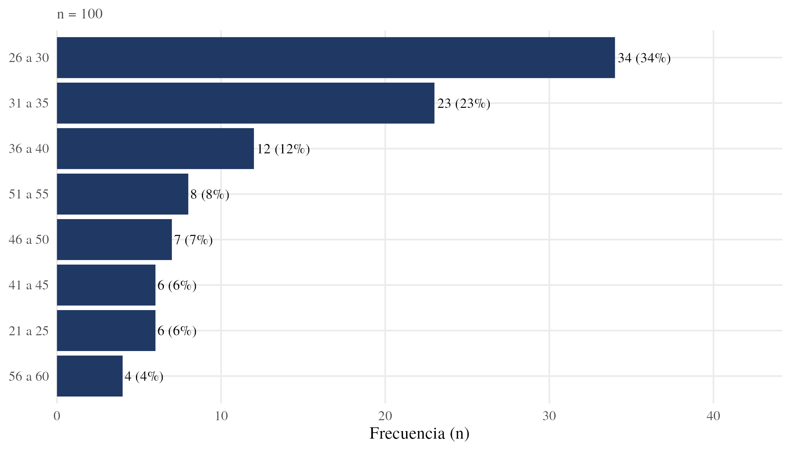

*Nota.* El eje horizontal muestra la frecuencia absoluta (n); el eje vertical, los rangos de edad en años, ordenados por frecuencia.

Fuente: Elaboración propia.

**Figura 8.** Área disciplinaria de la maestría de las personas interesadas (n = 100)

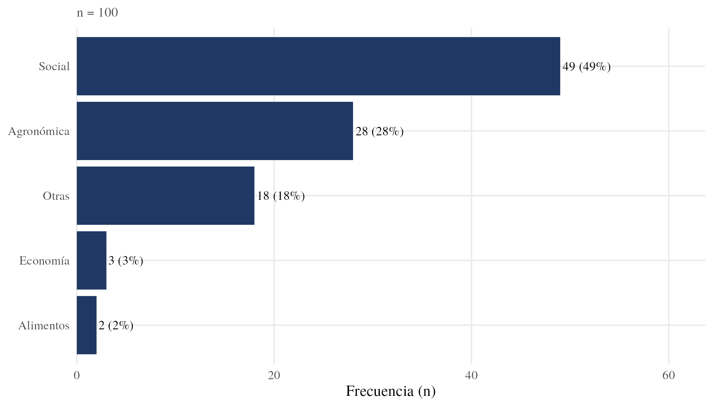

*Nota.* El eje horizontal muestra la frecuencia absoluta (n). La categoría «Economía» de la imagen, tal como está codificada en los datos, corresponde al área que el manuscrito denomina «económica» (anexo E).

Fuente: Elaboración propia.

**Figura 9.** Situación laboral de las personas interesadas (n = 98)

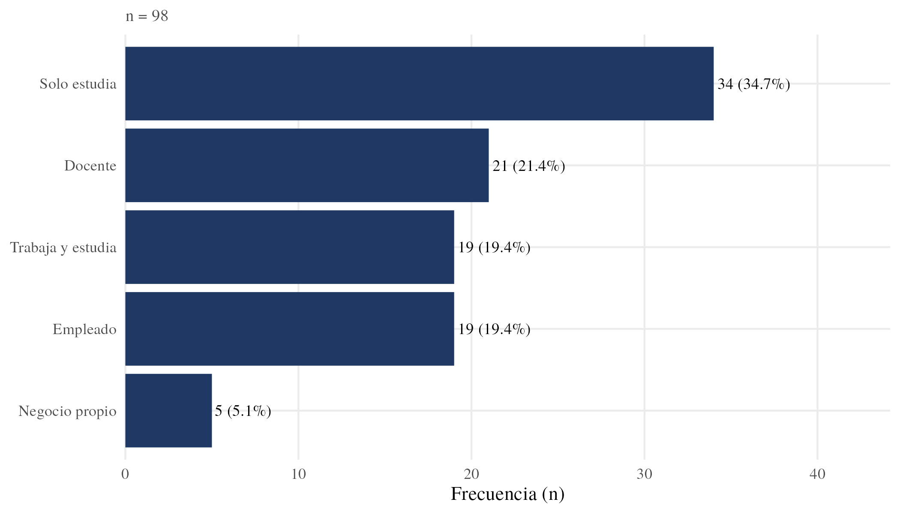

*Nota.* El eje horizontal muestra la frecuencia absoluta (n). Los porcentajes se calculan sobre las 98 personas con dato; la Tabla 2 del manuscrito los calcula sobre 100 y consigna aparte las dos sin dato.

Fuente: Elaboración propia.

**Figura 10.** Motivación principal para cursar el doctorado (n = 100)

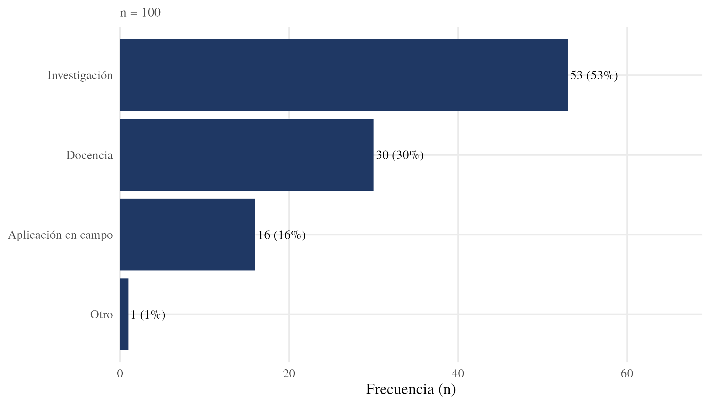

*Nota.* El eje horizontal muestra la frecuencia absoluta (n); junto a cada barra, el porcentaje sobre las 100 personas interesadas.

Fuente: Elaboración propia.

**Figura 11.** Plazo estimado para iniciar el doctorado (n = 100)

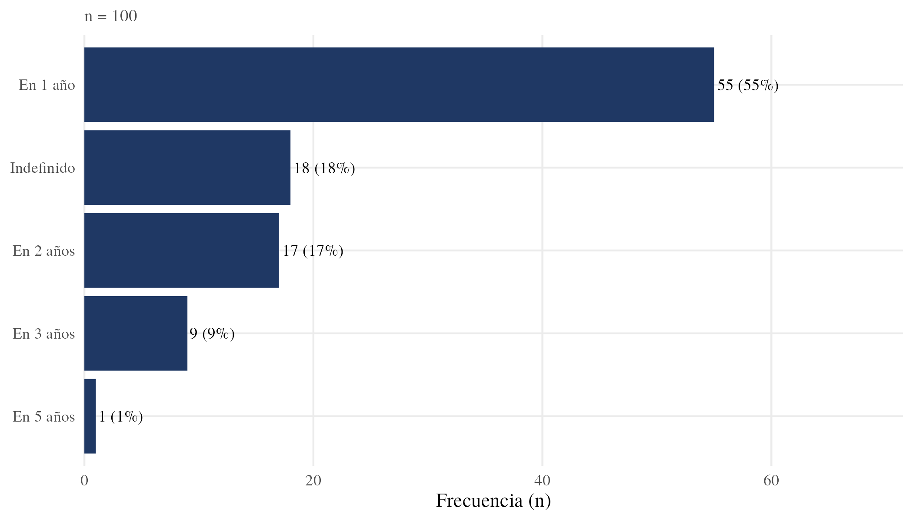

*Nota.* El eje horizontal muestra la frecuencia absoluta (n); junto a cada barra, el porcentaje sobre las 100 personas interesadas.

Fuente: Elaboración propia.

**Figura 12.** Plazo estimado de inicio según situación laboral (RQ6) (n = 98)

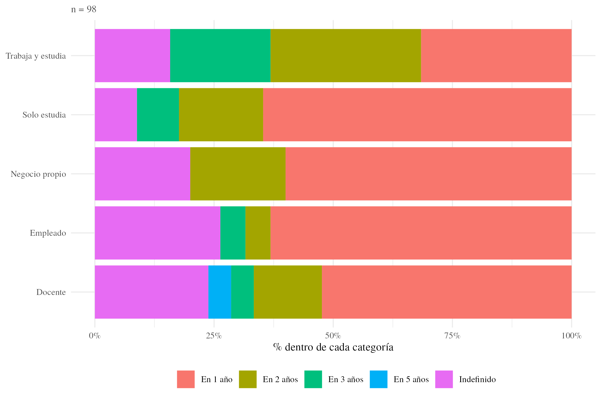

*Nota.* Cada barra suma 100 % dentro de su situación laboral; el eje horizontal indica el porcentaje de cada plazo.

Fuente: Elaboración propia.

**Figura 13.** Motivación principal según situación laboral (RQ6) (n = 98)

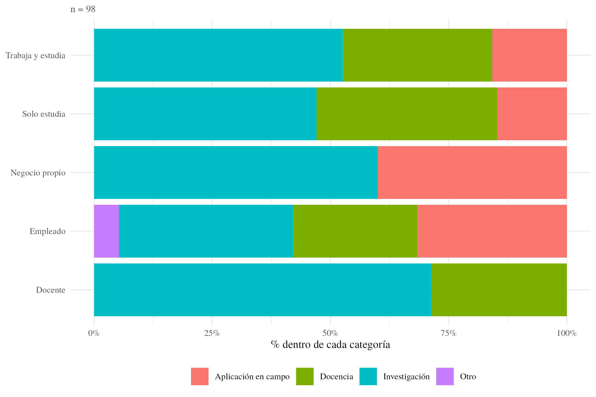

*Nota.* Cada barra suma 100 % dentro de su situación laboral; el eje horizontal indica el porcentaje de cada motivación.

Fuente: Elaboración propia.

**Figura 14.** Entidad federativa donde se cursó la maestría (n = 100)

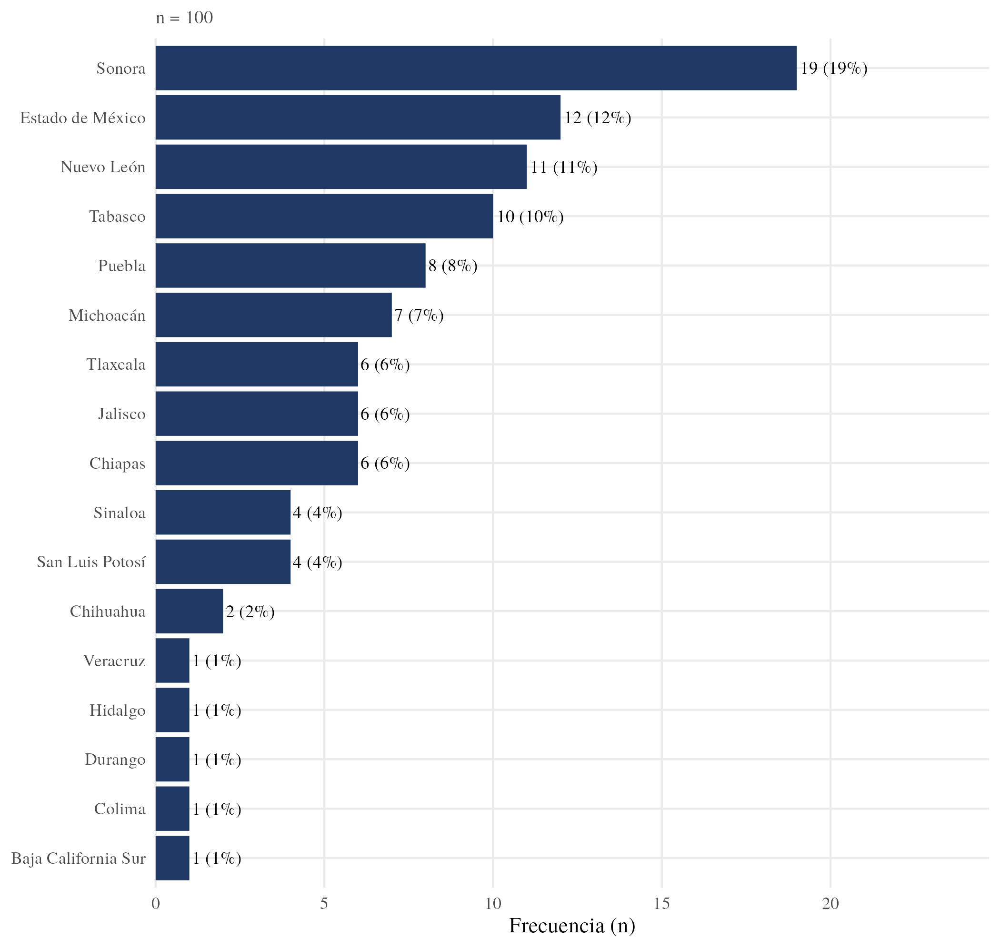

*Nota.* El eje horizontal muestra la frecuencia absoluta (n); junto a cada barra, el porcentaje sobre las 100 personas interesadas.

Fuente: Elaboración propia.

**Figura 15.** Lugar de residencia actual (n = 100)

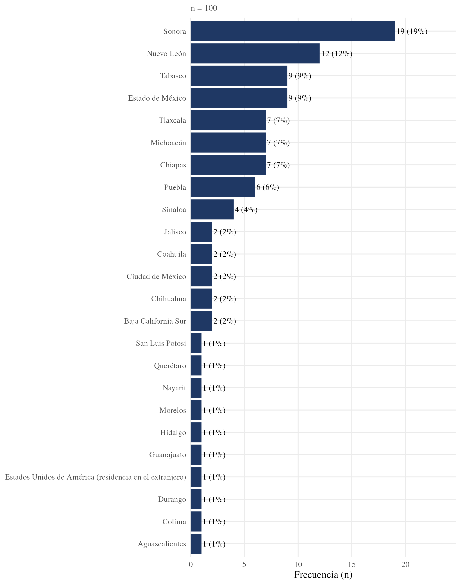

*Nota.* El eje horizontal muestra la frecuencia absoluta (n). Incluye un caso de residencia en el extranjero.

Fuente: Elaboración propia.

**Figura 16.** Personas interesadas por entidad donde cursaron la maestría (n = 100)

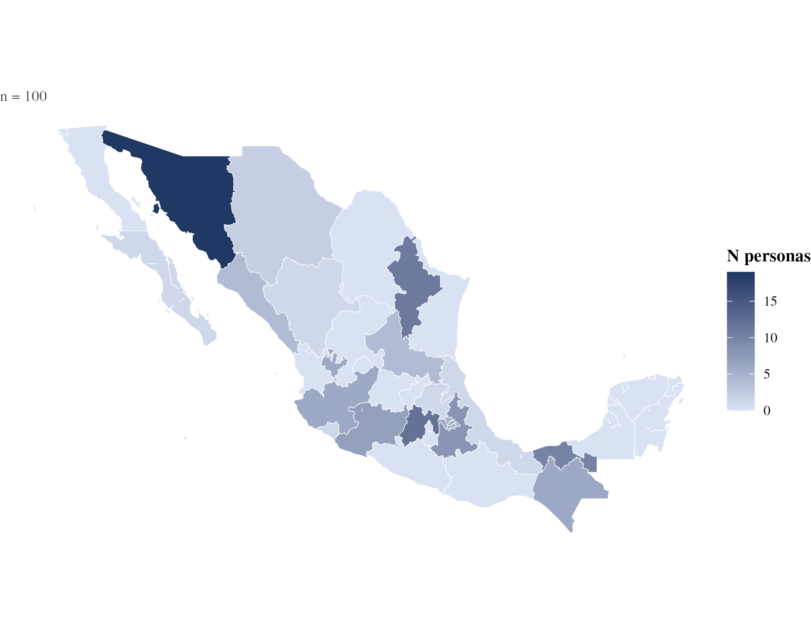

*Nota.* La intensidad del color indica el número de personas por entidad; las entidades sin casos aparecen en el tono más claro.

Fuente: Elaboración propia.

**Figura 17.** Personas interesadas por entidad de residencia (n = 100)

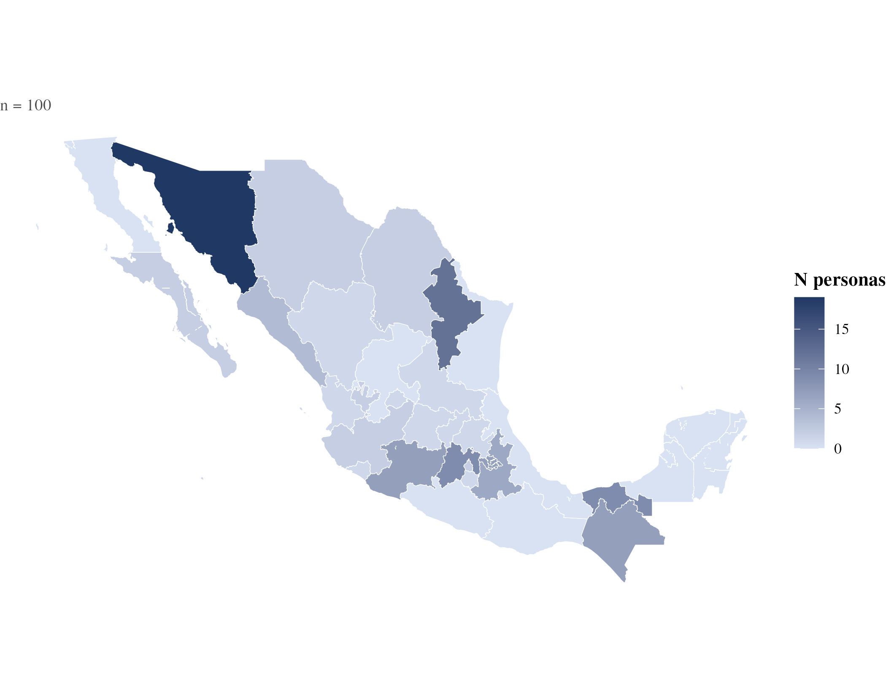

*Nota.* La intensidad del color indica el número de personas por entidad. El caso con residencia en el extranjero no se representa en el mapa.

Fuente: Elaboración propia.

---

*Versión para arbitraje ciego.* Las personas autoras y la institución sede se designan como Autor/a, y las instituciones del anexo B con un código. Los nombres se restituyen en la versión definitiva, tras la aceptación del artículo.
